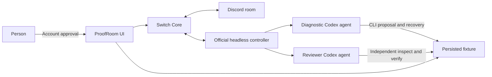

# ProofRoom

Evidence-backed recovery with a human decision, built for Flip the Switch 2026.

A person, a diagnostic Codex agent and an independent reviewer coordinate through
Switch and Discord to recover a controlled paused worker. The proposal, review,
account approval, execution and observed outcome are linked in an evidence ledger.

## Verified result

The real agent workflow processed 3/3 fixture deliveries and independently verified
zero queued deliveries and recovered=true. The person approved the reviewed proposal
in the signed-in product UI. See [the actual transcript and fixture state](evidence/live-agent-recovery.json).
The interface's local diagnostic/review buttons provide a separate rehearsal path.

## Architecture



Switch carries the shared history, scoped addressing and handoff between the person
and agents. The recovery engine exposes observable state and refuses stale evidence,
missing review/approval and repeated execution. Successful execution is distinct from
verified recovery. These are implemented prototype behaviors, not a claim of global novelty.

## Run

Windows, an A: drive, existing Node 24, PowerShell 7, Git and PostgreSQL 17 are
required. Put this source at A:/FlipTheSwitch on a fresh environment; do not overwrite
an existing private runtime. No Docker is used. Some scripts expect standard Windows
installation paths for existing executable files.

Follow [ordered setup](project/docs/reproduce.md) and [runtime provenance](project/docs/agent-runtime.md).
The prepared scripts have been exercised locally; a separate fresh-machine installation
has not yet been verified.

```powershell
& 'A:\FlipTheSwitch\runtime\bootstrap.ps1'
& 'A:\FlipTheSwitch\runtime\controller\install.ps1'
& 'A:\FlipTheSwitch\launch.ps1'
```

- Product UI: http://127.0.0.1:4173
- Switch Gateway: http://127.0.0.1:8765
- [Product guide](project/README.md)
- [Demo recording script](project/docs/demo-guide.md)
- [System design and limits](project/docs/architecture.md)

## Validation

All 18 current automated product tests passed. Two live helper guard checks refused replay
against the completed exercise without changing its bytes. An evidence consistency
check matched the saved run with current state and the actual reviewer reply.

The original stable controller's idle timeout caused reconnects. The pinned official
signed prerelease includes the upstream heartbeat-aware fix; both agents remained
attached with zero warnings in a 521-second observation, and a read-only agent reply
succeeded. [Controller check](evidence/controller-heartbeat-check.json).
This is a bounded check, not a long-duration soak.

## Scope and trust boundary

This is a controlled persisted queue fixture, not a production webhook outage.
Agents and operator share filesystem access; actor labels and prompts are cooperative
controls. Account-authenticated approval does not prove physical human presence.
There is no tamper-proof ledger or separately isolated production execution broker.
No provider credentials, bot tokens, private runtime data or existing upstream
checkout are distributed here. [Third-party notices](project/NOTICES.md).

No public video URL, hosted application or final hackathon entry is claimed by this
source snapshot. No original-source license has been selected by the owner yet;
third-party license terms remain included with their assets.

### Gateway UI overlay

Includes a checksum-guarded local Switch Gateway UI overlay: readable graph labels, + / minus / Fit viewport controls, responsive toolbars and table header fixes. See [overlay notes](runtime/gateway-ui/README.md) and its upstream license.

## Build story

[Read the published architecture and build story on AWS Builder Center](https://builder.aws.com/content/3Lh1ATcQwjUUeMzgpQ7cQI33kAk/proofroom-evidence-backed-ai-recovery-with-switch-and-discord).

## Render hosting

[Native free deployment instructions](deploy/render/README.md) and [Blueprint](render.yaml). Cloud setup creates a separate Switch server; local agents and Discord are not migrated automatically. Free hosting has sleep, ephemeral fixture storage and database expiration limits.
